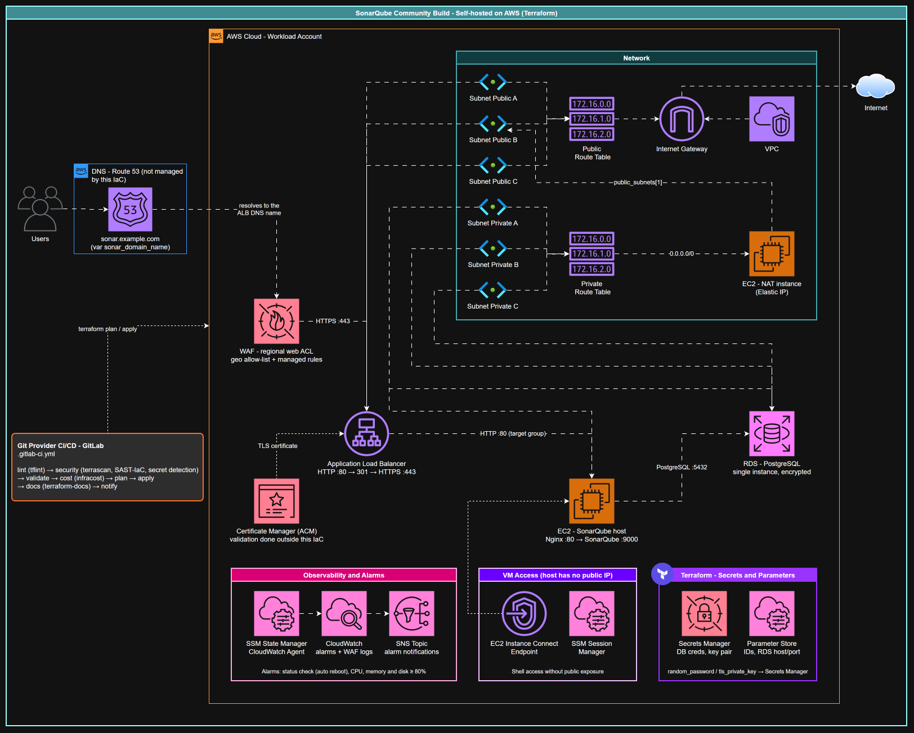

# SonarQube Community Build on AWS with Terraform

Terraform reference architecture to run a self-hosted **SonarQube Community Build** on AWS. It provisions the network, a NAT instance, an EC2 host bootstrapped by `user_data` (Java, SonarQube and Nginx), an RDS PostgreSQL database, an Application Load Balancer with an ACM certificate and a WAF, CloudWatch alarms delivered through SNS, and ships a GitLab CI pipeline for the IaC lifecycle.

## Architecture overview



Editable source: [media/sonarqube-aws.drawio](./media/sonarqube-aws.drawio). To refresh the PNG with draw.io desktop:

```bash
draw.io -x -f png --theme dark -b 10 -o media/sonarqube-aws.drawio.png media/sonarqube-aws.drawio
```

Request flow: Users → DNS (Route 53, managed outside this project) → Application Load Balancer (WAF attached; HTTP :80 redirects to HTTPS :443 with the ACM certificate) → Nginx on the EC2 host (:80) → SonarQube (:9000) → RDS PostgreSQL (:5432).

### What gets provisioned

| Area | Resources | Modules |
| --- | --- | --- |
| Network | VPC and Internet Gateway; public subnets with a public route table (`0.0.0.0/0` → IGW); private subnets with a private route table (`0.0.0.0/0` → NAT instance) | `vpc`, `public_subnet`, `private_subnet` |
| NAT | EC2 NAT instance (`t4g.nano`, Ubuntu 24.04 arm64, `iptables` masquerade) with an Elastic IP in the **second** public subnet. A NAT Gateway alternative is left commented in `modules/private_subnet/main.tf` | `ec2_nat_instance` |
| SonarQube host | EC2 instance in the **first** private subnet, no public IP, IMDSv2 required, detailed monitoring, gp3 root volume, generated key pair, IAM instance profile (SSM, CloudWatch Agent, S3, KMS, SES) | `ec2`, `key_pair` |
| Bootstrap | `user_data.tpl`: installs Java 17, downloads SonarQube `sonar_version`, creates a `systemd` unit, reads the DB credentials from Secrets Manager, configures Nginx as reverse proxy (`:80` → `:9000`) and installs the SSM agent | - |
| Database | RDS instance (PostgreSQL) in a subnet group over the private subnets, encrypted storage, random master password, security group allowing `5432` only from the host | `rds`, `security_group` |
| Edge | Internet-facing ALB in the public subnets, HTTP listener redirecting to HTTPS, HTTPS listener with the ACM certificate forwarding to the target group that points to the host | `load_balancer`, `target_group`, `certificate` |
| WAF | WAFv2 regional web ACL associated to the ALB: default action **block**, a geo-match **allow** rule for `waf_regional_country_codes` and the AWS managed rule groups you list; logs in CloudWatch Logs | `waf` |
| Host access | EC2 Instance Connect Endpoint in the host subnet (SSH `:22` is open only to the VPC CIDR) and SSM Session Manager (the SSM agent is installed by `user_data`) | `instance_connector_endpoint` |
| Observability | CloudWatch Agent installed and configured by SSM State Manager (targets the instance tags `CloudWatchAgent=true` and `os=Linux`); alarms for status check (two failed minutes trigger a reboot), CPU, memory and disk (≥ 80%); alarm actions to an SNS topic with your subscriptions (e-mail, for example) | `ec2_cw_agent`, `cloudwatch_alarm`, `cloudwatch_check_ec2_fail`, `sns` |
| Secrets and parameters | DB credentials and the key pair in Secrets Manager; VPC, IGW, subnet, security group, ALB, listener, instance and RDS identifiers in SSM Parameter Store | `secret_manager`, `parameter_store` |

Not provisioned by this project:

* **DNS**: no Route 53 resource is created. You create the record for `sonar_domain_name` pointing to the ALB and the ACM validation records.
* **Certificate validation**: `aws_acm_certificate` is created with `cert_validation_method`, but there is no `aws_acm_certificate_validation` resource.
* The modules `iam_role`, `iam_service_account` and `elastic_ip` exist under `modules/` but are not used by `main.tf`.
* `lb.logs` is declared in `variables.tf` but is not wired to anything.

## Requirements

* Terraform >= 1.3 (the variables use `optional()` attributes) and AWS provider `6.4.0` (pinned in `providers.tf`). The `random` and `tls` providers are resolved automatically.
* AWS credentials able to create the resources above.
* A Debian or Ubuntu AMI (arm64 or amd64) selectable through `ec2_img_owner` / `ec2_image`: the bootstrap uses `apt` (AWS CLI, Java, Nginx, SSM agent for the detected architecture) and the disk alarm expects the root device `nvme0n1p1` of Nitro instances.
* At least two public subnets (the NAT instance uses `public_subnets[1]`) and two private subnets in different AZs (RDS subnet group).

## Configuration

Every root variable is required (none has a default), so create a `terraform.tfvars` file (ignored by Git) before running. Example:

```hcl
account_region            = "us-east-1"
account_project_base_name = "sonar"
default_tags = {
  Project   = "sonarqube"
  ManagedBy = "terraform"
}

# Network
vpc_cidr = "172.16.0.0/16"
public_subnets = [
  { name = "public-a", cidr = "172.16.0.0/24", availability_zone = "us-east-1a" },
  { name = "public-b", cidr = "172.16.1.0/24", availability_zone = "us-east-1b" },
]
private_subnets = [
  { name = "private-a", cidr = "172.16.10.0/24", availability_zone = "us-east-1a" },
  { name = "private-b", cidr = "172.16.11.0/24", availability_zone = "us-east-1b" },
]

# SonarQube host (Debian 12 arm64)
ec2_name                                   = "sonarqube"
ec2_instance_type                          = "t4g.medium"
ec2_img_owner                              = ["136693071363"]
ec2_image                                  = ["debian-12-arm64-*"]
ec2_disk_size                              = 30
ec2_ip_public                              = false
ec2_instance_profile_aditional_permissions = []
ec2_ingress_rules                          = [] # :80 from the ALB and :22 are added by main.tf
ec2_egress_rules = [
  { from_port = 0, to_port = 0, protocol = "-1", cidr_blocks = ["0.0.0.0/0"] },
]

# Database (SonarQube supports PostgreSQL only)
sql_engine                  = "postgres"
sql_engine_version          = "16"
sql_instance_class          = "db.t4g.micro"
sql_database_name           = "sonarqube"
sql_allocated_storage       = 20
sql_backup_retention_period = 7
rds_ingress_rules           = [] # :5432 from the host is added by main.tf
rds_egress_rules            = []

# SonarQube (check the exact build at https://binaries.sonarsource.com/Distribution/sonarqube/)
sonar_version     = "25.3.0.104237"
sonar_domain_name = "sonar.example.com"

# Target group (ALB -> Nginx on the host)
tg_protocol            = "HTTP"
tg_port                = 80
tg_matcher_status_code = "200-399"

# Certificate (validate it in your DNS after the first apply)
cert_domain_name              = "sonar.example.com"
cert_domain_alternative_names = []
cert_validation_method        = "DNS"

# Load balancer
lb = {
  internal          = false
  lb_type           = "application"
  logs              = false
  delete_protection = false
}
lb_ingress_rules = [
  { from_port = 80, to_port = 80, protocol = "tcp", cidr_blocks = ["0.0.0.0/0"] },
  { from_port = 443, to_port = 443, protocol = "tcp", cidr_blocks = ["0.0.0.0/0"] },
]
lb_egress_rules = [
  { from_port = 0, to_port = 0, protocol = "-1", cidr_blocks = ["0.0.0.0/0"] },
]
listener_rule_http = {
  port                 = 80
  protocol             = "HTTP"
  default_action_type  = "redirect"
  redirect_port        = 443
  redirect_protocol    = "HTTPS"
  redirect_status_code = "HTTP_301"
}
listener_rule_https = {
  port                = 443
  protocol            = "HTTPS"
  ssl_policy          = "ELBSecurityPolicy-TLS13-1-2-2021-06"
  default_action_type = "forward"
}

# Alarm notifications
sns_protocol  = "email"
sns_endpoints = ["devops@example.com"]

# WAF: everything is blocked unless it comes from these countries and passes the managed rules
waf_regional_country_codes = ["BR"]
waf_managed_rule_groups = {
  AWSManagedRulesCommonRuleSet = {
    vendor_name          = "AWS"
    name                 = "AWSManagedRulesCommonRuleSet"
    priority             = 1
    rule_action_override = ["SizeRestrictions_BODY"] # scanner report uploads are large
  }
  AWSManagedRulesKnownBadInputsRuleSet = {
    vendor_name = "AWS"
    name        = "AWSManagedRulesKnownBadInputsRuleSet"
    priority    = 2
  }
}
waf_logs_retention_period = 30
```

## How to deploy

```bash
terraform init
terraform plan -out plan.tfplan
terraform apply plan.tfplan
```

After the apply:

1. **Validate the certificate.** Get the validation records with `terraform state show module.certificate.aws_acm_certificate.main` and create them in your DNS zone. The HTTPS listener can only be created once the certificate is issued, so the first apply may stop at the listener; run `terraform apply` again afterwards.
2. **Create the DNS record** for `sonar_domain_name` pointing to the ALB DNS name (AWS console or `aws elbv2 describe-load-balancers`). The project only outputs `ec2_host` and `ec2_ip` (private DNS and IP of the host).
3. **Confirm the SNS subscription** sent to each address in `sns_endpoints`.
4. Wait for the bootstrap to finish (a few minutes), open `https://<sonar_domain_name>` and change the default `admin` password. SSM State Manager installs the CloudWatch Agent within about 30 minutes.

Host access without a public IP:

```bash
# SSM Session Manager
aws ssm start-session --target <instance-id>

# SSH through the EC2 Instance Connect Endpoint (private key stored in Secrets Manager; Debian user is "admin")
aws ec2-instance-connect ssh --instance-id <instance-id> --connection-type eice --os-user admin
```

## State and secrets

### Remote backend

`providers.tf` has a commented S3 backend example. For shared environments, **always** use encryption and locking:

```hcl
terraform {
  backend "s3" {
    bucket         = "your-terraform-state-bucket"
    key            = "gitlab/terraform.tfstate"
    region         = "us-east-1"
    encrypt        = true
    dynamodb_table = "terraform-lock"
  }
}
```

### Sensitive data

Nothing sensitive is committed: `*.tfvars` files are ignored by Git, and the secrets are generated by Terraform and stored in AWS.

| Secret / parameter | Where | Content |
| --- | --- | --- |
| `<account_project_base_name>_db_credentials` | Secrets Manager | RDS host, port, username, password and database name (password from `random_password`) |
| `key-pair-<ec2_name>-vpc` | Secrets Manager | Private and public key of the host key pair (from `tls_private_key`) |
| `/rds/<account_project_base_name>/host` and `/port` | Parameter Store (SecureString) | RDS endpoint |
| `/ec2/instance-id/<ec2_name>`, `/vpc/...`, `/sg/...`, `/lb-...` | Parameter Store | Resource identifiers for reuse by other stacks |

These values also live in the Terraform state, so protect the backend (encryption and restricted access).

## CI/CD (GitLab)

`.gitlab-ci.yml` runs on every branch push: `lint` (tflint) → `security` (terrascan plus the GitLab SAST-IaC and Secret Detection templates) → `validate` → `cost` (infracost) → `plan` → `deploy` (apply) → `documentation` (terraform-docs) → `notify`. Merge request pipelines run only the `*-mr` jobs (tflint, terrascan, validate) and the security templates; a branch with an open merge request gets the merge request pipeline instead of the branch pipeline.

Points to know before enabling it:

* `apply` runs automatically after `plan` on any branch pipeline (there is no `when: manual`). Add a branch rule or a manual gate if you want one.
* `plan` and `apply` use the `1-terraform-aws` image from `ECR_BASE_URL_DEPLOY`; the other jobs rely on the runner default image providing `terraform`, `tflint`, `infracost` and `terraform-docs`.
* The `documentation` job injects the terraform-docs output into this README between the `BEGIN_TF_DOCS` / `END_TF_DOCS` markers below and pushes the commit with `GITLAB_TOKEN`.
* CI variables referenced: `AWS_ACCESS_KEY`, `AWS_SECRET_KEY`, `AWS_REGION`, `ECR_BASE_URL_DEPLOY`, `GITLAB_TOKEN`, `INFRACOST_API_KEY` (cost job) and `NOTIFY_WEBHOOK_URL` / `CLOUD_PROVIDER` (notify jobs from the remote include `Tooark/notification-trigger-url-include`).

## Terraform reference

Generated by terraform-docs in the pipeline.

<!-- BEGIN_TF_DOCS -->
<!-- END_TF_DOCS -->

## License

This project is licensed under the [MIT License](./LICENSE).
