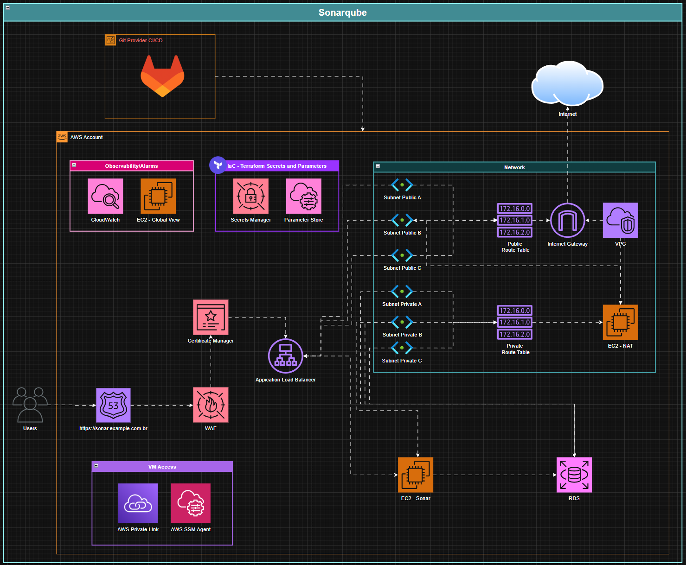

# Projeto IAC - Implantação do SonarQube na AWS com Terraform

This repository contains Terraform modules and templates to provision a production-ready SonarQube Community Build Self-Hosted environment on AWS. It serves as a reference architecture covering everything from base networking to automated CI/CD package update.

### Project Stack
* **Core Infra:** Modules for VPC, Subnets, EC2, EBS, RDS, and IAM.
* **Provisioning:** `user_data` to provision and configure the SonarQube instance.
* **CI/CD:** Example `.gitlab-ci.yml` for GitLab CI/CD to automate IaC deployments.
* **Observability & DNS:** Native integration with CloudWatch and Route53.

## Overview architecture



### State & Secrets Management

#### Remote Backend
The `providers.tf` file includes a commented S3 backend example. For shared environments, **always** use encryption and locking:

```hcl
terraform {
  backend "s3" {
    bucket         = "your-terraform-state-bucket"
    key            = "gitlab/terraform.tfstate"
    region         = "us-east-1"
    encrypt        = true
    dynamodb_table = "terraform-lock"
  }
}
```

### How to run the project

1.  **Initialize Terraform:**
    ```bash
    terraform init
    ```
2.  **Plan the deployment:**
    ```bash
    terraform plan
    ```
3.  **Apply the changes:**
    ```bash
    terraform apply
    ```
    
### Sensitive Data Handling
Never commit secrets to version control. This project is structured to pull sensitive values (DB passwords, tokens, SES keys) via AWS Secrets Manager or local files ignored by Git.

locals.tf expects files like root.json or ses.json. Ensure your CI pipeline injects these files or that they exist locally only during testing.

### License
This project is licensed under the [MIT License](./LICENSE).